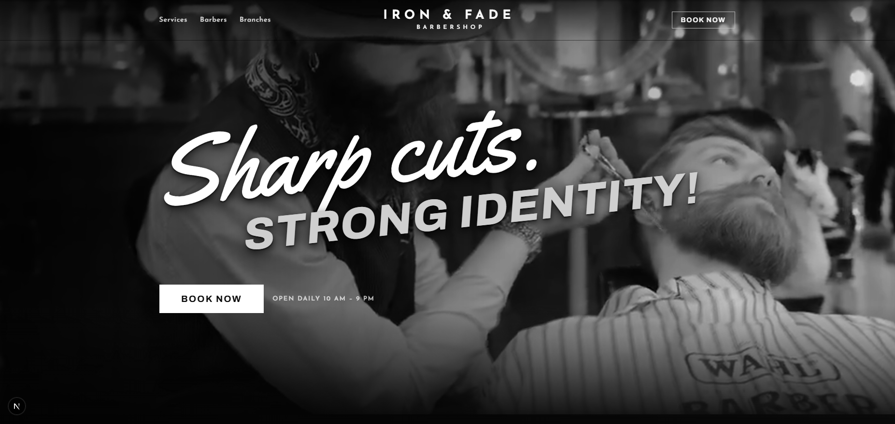
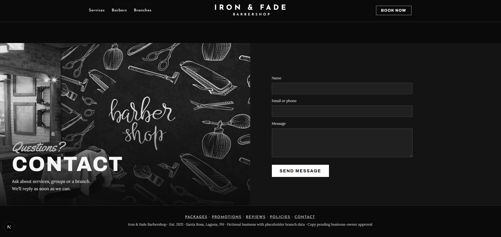

<div align="center">
  
  
  # Iron & Fade
  
  [](https://nextjs.org/)
  [](https://react.dev/)
  [](https://www.framer.com/motion/)
  [](LICENSE)
  
  ### Modern Barber Shop Showcase
  *Built with Next.js & Framer Motion*
  
  [Demo](https://iron-and-fade-barber-showcase.vercel.app) • [Features](#features) • [Quick Start](#quick-start)
</div>

---

## Quick Start

```bash
npm install && npm run dev
```

Visit → http://localhost:3000
## Features


*Modern, animated landing page with smooth transitions*

- 🎨 **Modern Design** - Clean, professional interface with smooth animations
- 📅 **Smart Booking System** - Group scheduling with automatic discount rules
- 💈 **Service Showcase** - Dynamic service cards with pricing
- ⭐ **Reviews & Testimonials** - Customer feedback display
- 📱 **Responsive** - Mobile-first design approach
- ⚡ **Fast Performance** - Optimized with Next.js 15


*Interactive booking dialog with form validation*

## Project Structure

```
├── app/
│   ├── globals.css          # All styles and palette (--c, --c2, --b, --a, --a2)
│   ├── layout.jsx           # Root layout with metadata
│   └── page.jsx             # Main page component
├── components/
│   ├── Booking.jsx          # Booking dialog component
│   ├── Landing.jsx          # Landing page sections
│   ├── Providers.jsx        # Context providers
│   └── Sprite.jsx           # SVG sprite component
├── lib/
│   ├── data.js              # Services, branches, barbers, awards, reviews
│   └── booking.js           # Availability, scheduling, discount rules
└── public/
    ├── hero.jpg             # Hero section background
    ├── contact.jpg          # Contact section background
    └── favicon.svg          # Site favicon
```

## Customization

### Images
Replace the following with your own photos (keep the same names):
- `public/hero.jpg` - Hero section background
- `public/contact.jpg` - Contact section background

### Data
Update placeholder data in `lib/data.js`:
- Services and pricing
- Branch locations
- Barber profiles
- Awards and reviews

**Note:** Remote barber/branch/review photos are hot-linked placeholders; replace with licensed images.

### Colors
Modify the CSS custom properties in `app/globals.css`:
```css
--c: #1a1a1a;    /* Primary dark */
--c2: #2c2c2c;   /* Secondary dark */
--b: #f5f5f5;    /* Light background */
--a: #d4af37;    /* Gold accent */
--a2: #b8941f;   /* Dark gold */
```

## License

MIT
